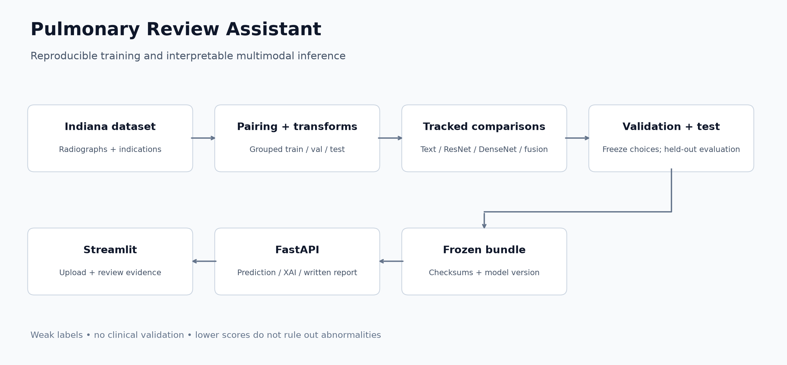
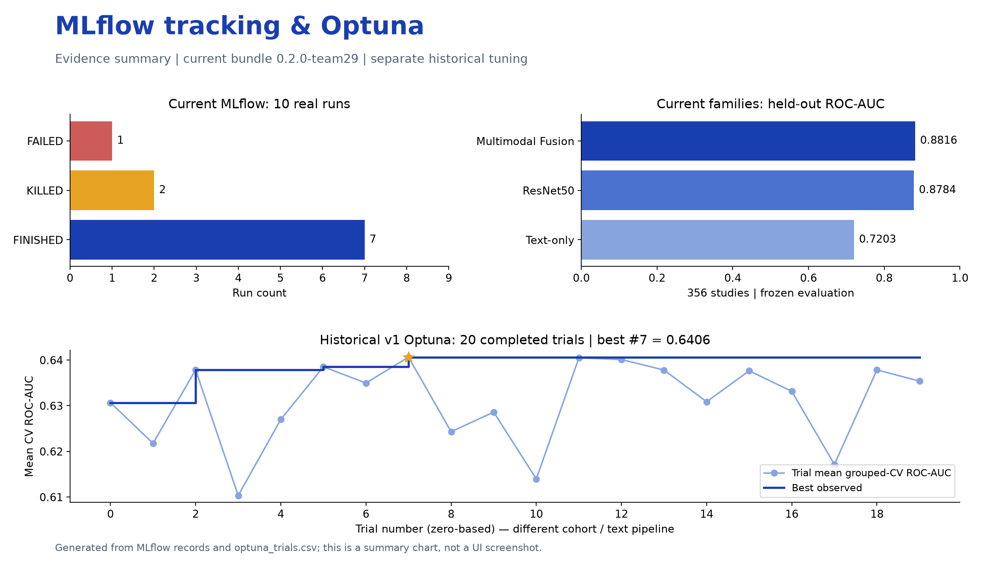
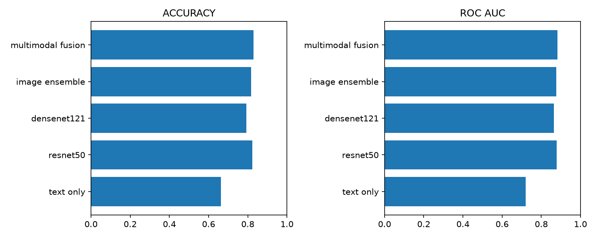

# Pulmonary Review Assistant

### Chest X-rays, clinical context, and interpretable model evidence — together.

A multimodal machine learning project that combines chest radiographs with clinical
indications, compares image and text baselines, and delivers explainable predictions
through a containerized API and web interface.

Built for **Multimodal Clinical Decision Support for Pulmonary Pathology**, Samsung
Innovation Campus — AI Track. Training, evaluation and serving use Python source
files; no notebook execution is required.

**Clinician verification is required.** Outputs are uncalibrated scores against weak
annotation labels. Review priority is illustrative, and generated reports do not
establish a diagnosis or clinical urgency.

[Live UI preview](#see-it-in-action) · [Get started](#getting-started) · [Architecture](#architecture) ·
[Dataset](#dataset) · [Results](#model-comparison) · [API](#api-reference) ·
[Documentation](#documentation)

## What you can do

- **Analyze two modalities:** upload an X-ray and its associated clinical indication.
- **Inspect the evidence:** view Grad-CAM attention and signed text-token contributions.
- **Read a structured report:** Predicted Class, Impression, Visual Findings,
  Clinical Context and Recommendation, with a text download.
- **Reproduce the experiments:** grouped splits, tracked baselines, fusion comparisons
  and a frozen model bundle with checksums.

The report generator uses deterministic rules and measured attribution evidence.
It is not a trained image-to-text model. Text attribution uses token occlusion,
rather than SHAP. See [report generation](docs/report_generation.md).

## See it in action

Actual screenshots from an upload-and-analysis test in the running Streamlit app.

### From X-ray to prediction

Upload a radiograph, enter its clinical indication, and inspect the predicted
class, model score, review priority and Grad-CAM overlay in one view.


This selected demonstration case, UID 1330, returns **Normal** with an abnormality
model score of **1.5%**. It illustrates the interface, not overall model performance.

### From model evidence to a readable report

Inspect signed text contributions, read the structured clinical report, and
download the report text or full JSON response.


## Architecture



The deployed model averages ResNet50 and DenseNet121 image scores and combines
them with a TF-IDF text classifier: **70% image ensemble + 30% text**. Images use
384 × 384 grayscale letterboxing; text uses the clinical indication and optional
comparison context. The decision threshold, **0.49**, was selected on validation.
FastAPI serves the checksummed bundle; Streamlit calls it over HTTP. Grad-CAM,
token occlusion and a deterministic report make the model's behavior inspectable.

The original early-fusion workflow remains available as a separate reference
experiment. The [team model review](docs/technical_evidence_report.md) explains the
reproduction, model selection and reporting decision.

See the [architecture documentation](docs/architecture.md) for the training and
serving flow.

## Dataset

The project uses the Indiana University chest X-ray collection through the
[raddar Kaggle mirror](https://www.kaggle.com/datasets/raddar/chest-xrays-indiana-university).
The original collection and its preparation are described in the
[collection publication](https://pmc.ncbi.nlm.nih.gov/articles/PMC5009925/).

| Asset | Downloaded data / selected experiment |
| --- | --- |
| Report records | 3,851 |
| Image records | 7,466 |
| Selected binary studies | 2,371: 1,343 Normal; 1,028 Abnormal |
| Selected image rows | 4,543 |
| Train / validation / test studies | 1,660 / 355 / 356, grouped by report UID |
| Model inputs | 384 × 384 padded image + cleaned indication / comparison |

Uncertain and poor-quality cases are excluded; a frontal view is required.
Current findings, impression and structured tags are excluded from predictor
text. Tags and a documented impression-based strict rule define the weak-label
cohort. UID is not a verified patient identifier. Exact-image hashes were audited.

For provenance, the data dictionary, label rules and exact split counts, read
[Data Assets](docs/data_assets.md).

## Technology stack

| Technology | Responsibility |
| --- | --- |
| PyTorch + torchvision | CNN training, image ensembles and Grad-CAM |
| Scikit-Learn | TF-IDF, classical baselines, scaling and evaluation |
| FastAPI + Pydantic | Typed API contracts, input validation and model serving |
| Streamlit | Image/text upload, predictions, explanations and reports |
| Docker + Compose | Separate CPU-serving API and UI containers with health checks |
| MLflow + Optuna | Experiment tracking and hyperparameter search |
| pandas, NumPy, Pillow | Metadata preparation, arrays and image transforms |

## Getting started

Commands below use **PowerShell** from the repository root. Python **3.12** is the
tested version. Docker deployment requires Docker Desktop with Linux containers
and Compose; Windows installations also need WSL/virtualization enabled.

### 1. Install the Python environment

Clone or download this repository, open a terminal in its root, then run:

```powershell
py -3.12 -m venv .venv
.\.venv\Scripts\python.exe -m pip install --upgrade pip
.\.venv\Scripts\python.exe -m pip install torch==2.13.0 torchvision==0.28.0 --index-url https://download.pytorch.org/whl/cpu
.\.venv\Scripts\python.exe -m pip install -c constraints-cpu.txt -e ".[ui,data,dev]"
```

These commands install CPU dependencies for local serving and development. For
NVIDIA training, install a matching CUDA-enabled Torch/torchvision pair instead of
the CPU pair, following the [official PyTorch installation guide](https://pytorch.org/get-started/locally/).

### 2. Prepare a serving bundle

**Model binaries and raw data are not tracked in Git.** A fresh checkout does not
contain a ready-to-run trained model. Either restore a trusted, complete bundle
from your own experiment artifacts or follow [Reproduce the workflow](#reproduce-the-workflow)
to train and export one.

The current late-fusion bundle must contain:

```text
artifacts/team_bundle/
├── manifest.json
├── resnet50.pt
├── densenet121.pt
└── text_model.joblib
```

Keep the manifest and its corresponding files together. The API checks file
hashes and preprocessing compatibility on startup. Without a verified bundle,
`/ready` and inference return **503**. See [artifact layout](artifacts/README.md).

### 3. Build and start Docker

With the bundle present and Docker Desktop running:

```powershell
docker compose build
docker compose up -d --wait --wait-timeout 180
docker compose ps
Invoke-RestMethod http://localhost:8080/ready
```

| Service | Address |
| --- | --- |
| Streamlit application | <http://localhost:8501> |
| Interactive API documentation | <http://localhost:8080/docs> |
| API readiness | <http://localhost:8080/ready> |

Both services should report **healthy**. Compose mounts the bundle read-only,
runs services as non-root users and binds published ports to localhost. Inference
inside Docker uses CPU; the UI calls `http://api:8080` on the container network.
The first build downloads dependencies and can take several minutes.

To inspect logs or stop the stack:

```powershell
docker compose logs --tail 30 api ui
docker compose down
```

Subsequent starts can reuse the built images with `docker compose up -d --wait`.
See the [Docker demo guide](docs/docker_demo.md) for verification and an optional
trusted local dependency-cache rebuild.

### Alternative: run locally

Use the same Python environment and bundle. In the first terminal:

```powershell
$env:MODEL_BUNDLE = 'artifacts/team_bundle'
.\.venv\Scripts\python.exe -m uvicorn app.main:app --host 127.0.0.1 --port 8080
```

In a second terminal, also at the repository root:

```powershell
$env:API_URL = 'http://127.0.0.1:8080'
.\.venv\Scripts\python.exe -m streamlit run ui/app.py --server.address 127.0.0.1 --server.port 8501
```

Choose either the local services or Docker for these ports; stop the other stack
before starting a replacement.

## API reference

| Method | Endpoint | Purpose / response |
| --- | --- | --- |
| `GET` | `/health` | Process liveness, model status and model version; may report `not_ready` |
| `GET` | `/ready` | Returns 200 only when a verified model is loaded; otherwise 503 |
| `GET` | `/model-info` | Model kind, classes, threshold, preprocessing and selection metadata |
| `POST` | `/predict` | Class, score, priority, readable attention region and generated report |
| `POST` | `/explain` | Nested prediction, report, base64 PNG Grad-CAM and signed token contributions |
| `GET` | `/metrics` | Process-local request/error counts and latency totals; JSON, not Prometheus format |
| `GET` | `/docs` | Interactive Swagger UI |
| `GET` | `/openapi.json` | Machine-readable API schema |

Both POST endpoints accept `multipart/form-data`:

| Field | Required | Contract |
| --- | --- | --- |
| `image` | Yes | PNG/JPEG; maximum 10 MiB and 20 million decoded pixels |
| `indication` | Yes | Nonempty clinical indication; maximum 4,000 characters |
| `comparison` | No, for the current bundle | Prior-study context; used only if the deployed model was trained for it |

DICOM upload is not supported. `/predict` also computes attribution because its
report uses that evidence. Its response includes `predicted_class` (`Normal` or
`Abnormal`), the original `predicted_label`, `probability`, `threshold`,
`priority_tier`, `priority_reason`, `model_version`, `calibrated`, `gradcam_region`
and `generated_report`. Despite its API field name, `probability` is an uncalibrated
model score, not an established disease probability.

If the local `demo_images/` folder is available, try a matched public-data case:

```powershell
curl.exe --fail-with-body http://localhost:8080/predict -F "image=@demo_images/01_true_negative_uid_1330.png" -F "indication=XXXX-year-old male with shortness of breath."
```

Otherwise, substitute your image path and its actual indication. `XXXX` is original
deidentified dataset text. Missing inputs return 422; unsupported upload MIME
types return 415; oversized uploads return 413.

## Reproduce the workflow

The full dataset archive is approximately **14 GB**, with additional disk space
needed for extraction, processed images, environments and model artifacts.

### Download and configure

```powershell
.\.venv\Scripts\python.exe -m pulmonary.cli download
```

The downloader uses KaggleHub and writes `data/download_manifest.json` and
`configs/local.yaml`. The latter extends the default configuration and points
`data_root` to the extracted files. If you already have the dataset, supply that
path in `configs/local.yaml`. Complete any authentication required by Kaggle
without committing credentials.

### Prepare, train and evaluate

Run the selected team approach as Python files:

```powershell
.\.venv\Scripts\python.exe scripts/run_team_classification.py prepare
.\.venv\Scripts\python.exe scripts/run_team_classification.py train
.\.venv\Scripts\python.exe scripts/export_team_bundle.py
.\.venv\Scripts\python.exe scripts/build_team_evidence.py
```

Training enforces **batch size 8**, CUDA AMP, at most **18 epochs** per CNN and
early-stopping patience 2. Validation selects fusion weights and balanced-accuracy
thresholds. Finalization freezes those choices before one held-out evaluation,
which writes a test lock. TF-IDF and metadata scaling are fitted on training data.
The tested GTX 1660 SUPER backend settings and checkpoint restarts are recorded
in the [review](docs/technical_evidence_report.md). CPU training is supported but slow.

The original v1 pipeline remains in `pulmonary.cli`; its artifacts, cohort and
10:1 cost-sensitive decision policy are separate from this reproduction.
Use a new `--output` directory for a new experiment, and keep existing evidence.

## Experiment Tracking (MLflow)

MLflow records training parameters, epoch losses, checkpoint/selection evidence
and frozen evaluation metrics. The current database contains **10 runs** in
`team29-classification-reproduction`: seven finished, two killed and one failed.
Interrupted attempts remain part of the record. Five finished evaluation runs
cover the text-only, image-only and multimodal models.

From the project root, with the Python environment installed, run:

```powershell
.\.venv\Scripts\python.exe -m mlflow ui --backend-store-uri sqlite:///artifacts/team_classification/mlflow.db --host 127.0.0.1 --port 5000
```

Open **[MLflow at localhost:5000](http://127.0.0.1:5000)**, select
`team29-classification-reproduction`, and compare the `*-frozen-evaluation` runs.
Display `test_accuracy`, `test_f1` and `test_roc_auc`; open the CNN training runs
for `train_loss` and `validation_loss` histories and their logged parameters.

The earlier pipeline used **Optuna: 20 completed trials**, optimizing grouped
training-fold ROC-AUC. Its best historical trial achieved **0.6406** mean CV
ROC-AUC with `C=0.9163741809` and `max_features=1000`. That study uses a different
cohort and text pipeline. The current bundle uses a separate validation search:
12 text settings and 21 fusion weights, with selected text `C=0.3` and 70% image /
30% text fusion. Optuna did not tune the deployed fusion model.

To inspect the historical runs alongside the current experiment:

```powershell
.\.venv\Scripts\python.exe -m mlflow ui --backend-store-uri sqlite:///artifacts/mlflow.db --host 127.0.0.1 --port 5001
```

**Fresh checkout:** databases and run artifacts are intentionally excluded from
Git. Restore the separately supplied tracking archive from the project root
before launching the current UI:

```powershell
Expand-Archive -LiteralPath dist/SIC_0.2.0-team29_tracking_evidence.zip -DestinationPath .
```

The historical database requires its original local artifacts; it is separate
from that current-run archive. If no tracking data is available, use the saved
evidence below rather than creating an empty database with `mlflow ui`.



This generated summary chart uses real saved records. See the
[tracking evidence](docs/technical_evidence_report.md#mlflow-experiment-tracking-and-optuna-optimization-history),
[current run snapshot](reports/evidence/team29/mlflow_tracking_snapshot.json),
[historical tracking snapshot](reports/evidence/tracking_snapshot.json) and
[Optuna trials](reports/evidence/optuna_trials.csv). Regenerate the chart with
`python scripts/build_tracking_evidence.py`.

## Model performance

Current release: **`0.2.0-team29-47e281fc`**, loaded from `artifacts/team_bundle`.

Local reproduction on **356 held-out studies / 681 images**. F1 refers to the
abnormal weak-label class. Each model uses its validation-selected threshold.

| Model | Accuracy | F1-score | ROC-AUC |
| --- | ---: | ---: | ---: |
| Text-only — TF-IDF + Logistic Regression | 66.29% | 0.5652 | 0.7203 |
| Image-only — ResNet50 | 82.30% | 0.7961 | 0.8784 |
| Image-only — DenseNet121 | 79.21% | 0.7658 | 0.8644 |
| Image ensemble — ResNet50 + DenseNet121 | 81.74% | 0.7855 | 0.8757 |
| Multimodal late fusion — deployed | 82.87% | 0.7918 | 0.8816 |

The deployed threshold is **0.49**, selected by validation balanced accuracy.
Fusion recall is **75.32%** and precision **83.45%**. Fusion slightly improves
accuracy and ROC-AUC over ResNet50; ResNet50 has the higher F1. These differences
do not establish statistically reliable superiority. Scores are uncalibrated.



The [results CSV](reports/evidence/team29/ablation_results.csv) and
[model review](docs/technical_evidence_report.md) contain the evidence. Metrics average
image scores within a UID; the UI analyzes one image per request. The earlier v1
experiment used a different cohort and cost objective and is not directly comparable.

The report stays rule-based by default. A separately tested FLAN-T5 adapter is
available for experimental report drafting; the review explains its limitations.
It loads the export of
[notebooks/Team29_Report_Generation_Final.ipynb](notebooks/Team29_Report_Generation_Final.ipynb):
IU-classifier finding tags on CheXpert-only XRV features plus forced findings. Exports
tagged with the OpenI-trained `densenet121-res224-all` weights are rejected.

## Verification

```powershell
.\.venv\Scripts\python.exe -m pytest -q
.\.venv\Scripts\python.exe -m ruff check src app ui tests scripts/build_presentation.py scripts/verify_docker_stack.py
```

With Docker running, the trained bundle loaded and local demo inputs present:

```powershell
.\.venv\Scripts\python.exe scripts/verify_docker_stack.py
```

The container verifier checks readiness, real prediction and report responses,
Grad-CAM, invalid-input handling and report rendering inside the UI container.
Both containers have passed these checks locally. Detailed execution evidence is
in [the validation record](reports/validation.md) and the generated functional
reports. Artificial fixtures validate software behavior, not clinical performance.

## Repository map

```text
app/                       FastAPI service and response schemas
ui/                        Streamlit client and its Dockerfile
src/pulmonary/             Data, models, evaluation, XAI, inference and CLI
src/report_generator.py    Rule-based written reports
notebooks/                 Final Team29 learned report-generation notebook
configs/                   Training and runtime configuration
scripts/                   Verification, presentation and workflow utilities
tests/                     Data contracts, API, model integration and UI checks
docs/                      Architecture, data assets and technical guides
data/                      Local source dataset and cache (not tracked)
artifacts/                 Local splits, checkpoints and serving bundle (not tracked)
reports/                   Validation record and local generated evidence
```

## Documentation

Rebuild the submission documents and deck from the saved current results:

```powershell
.\.venv\Scripts\python.exe -m pip install -e ".[presentation,demo]"
.\.venv\Scripts\python.exe scripts/build_submission_documents.py
.\.venv\Scripts\python.exe scripts/build_technical_evidence_docx.py
.\.venv\Scripts\python.exe scripts/build_presentation.py
```

The deck uses the local reference template when present and a matching blank
canvas otherwise. See the runbook for refreshing live screenshots and recording
the fallback. Submit the separately packaged model archive alongside the source;
raw data and model weights remain outside Git.

| Guide | Contents |
| --- | --- |
| [Data Assets](docs/data_assets.md) | Provenance, dictionary, transforms, labels and exact splits |
| [Technical evidence — Word](docs/technical_evidence_report.docx) | Current ablation, ROC/PR/confusion plots, XAI, notebook analysis and functional evidence |
| [Technical evidence — Markdown](docs/technical_evidence_report.md) | Rebuildable source with embedded evidence images |
| [Presentation outline](docs/presentation_outline.md) | Source outline and notes; generated PowerPoint files are excluded from GitHub |
| [Demo runbook](docs/demo_runbook.md) | Docker startup, live cases and recorded fallback |
| [Submission checklist](docs/final_submission_checklist.md) | Mapping to all eight official SIC package items |
| [Data methodology](docs/data_methodology.md) | Leakage controls, task boundaries and evaluation design |
| [Architecture](docs/architecture.md) | Training-to-serving flow |
| [Explainability](docs/xai_methodology.md) | Image and text attribution methodology |
| [Report generation](docs/report_generation.md) | Report format and interpretation |
| [Docker demonstration](docs/docker_demo.md) | Startup, requests, logs and container verification |

## Scope and limitations

The target is a broad thoracic abnormality proxy derived from structured tags,
not a diagnosis of individual pulmonary conditions. Uncertain labels are excluded,
clinical indications are short, and external validation and score calibration are
absent. UID separation does not itself prove patient independence. Grad-CAM
describes image-space attention, not verified anatomy or lesion detection. Reports
are rule-based summaries of model evidence and require clinician verification.

Source data, model artifacts and third-party assets retain their respective
upstream terms; their presence in a local workspace does not grant redistribution
rights. Dataset attribution and acquisition details are in [Data Assets](docs/data_assets.md).
