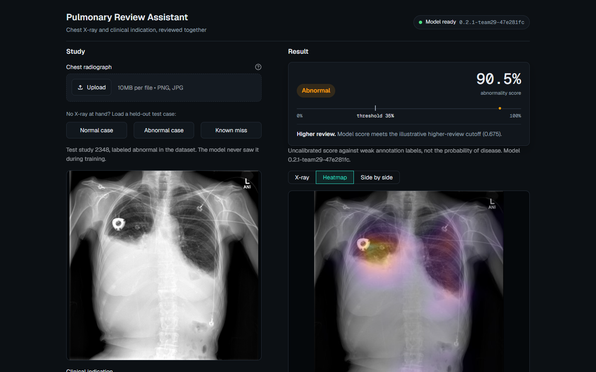
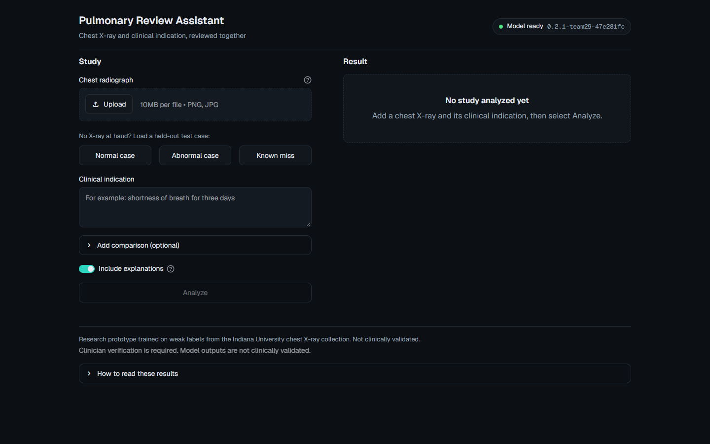
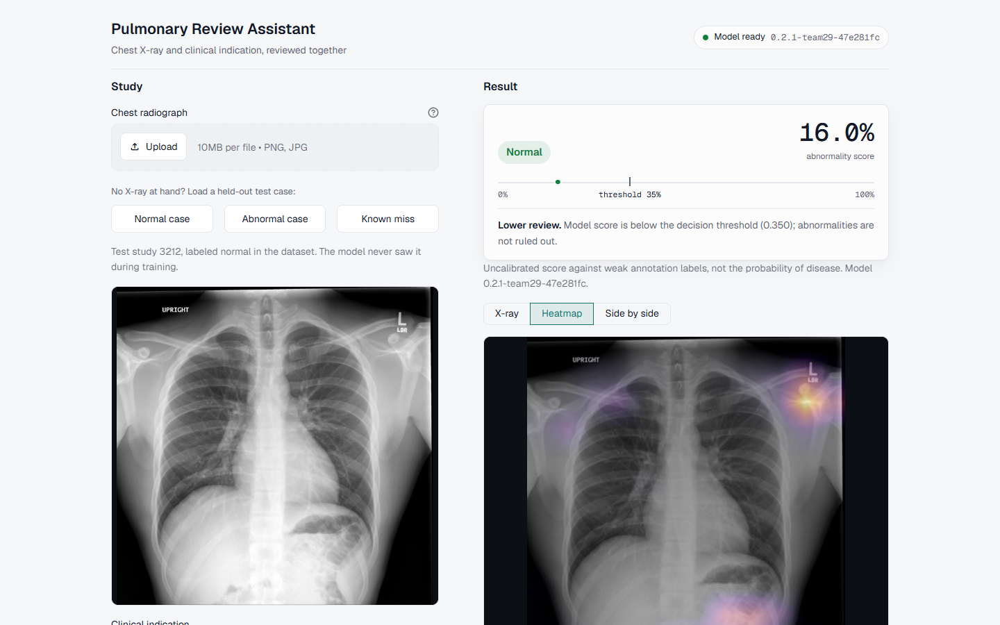
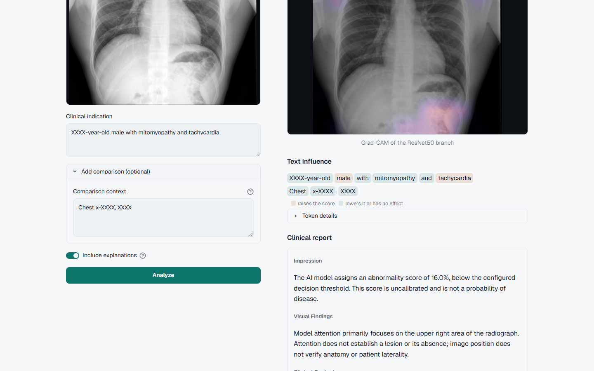
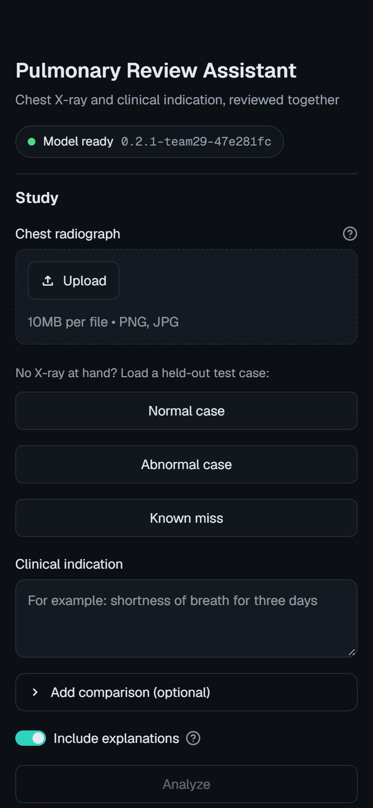
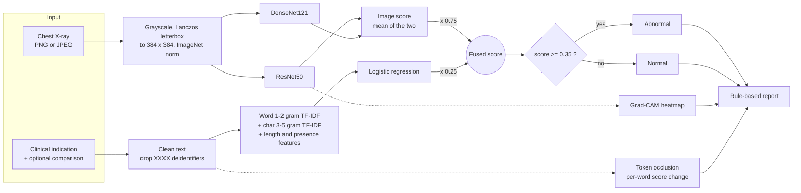
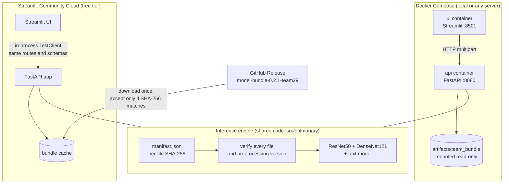
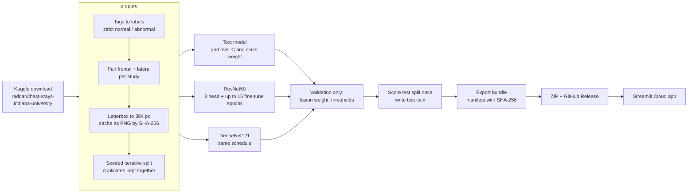

# Pulmonary Review Assistant

A multimodal model that reads a chest X-ray together with the clinical indication written for it,
scores the study as normal or abnormal, and shows you why: a Grad-CAM heatmap over the image, the
words in the indication that moved the score, and a plain-language report.

Built by Team 29 for the Samsung Innovation Campus AI track (Multimodal Clinical Decision Support
for Pulmonary Pathology). Everything runs from Python source files. The two notebooks in
`notebooks/` document experiments; nothing in the serving path depends on them.

**Live app:** <https://multimodal-pulmonary-diagnostics.streamlit.app/>

> **This is a research prototype.** The model was trained on weak labels derived from radiology
> tags, its scores are not calibrated probabilities, and it has not been validated on patients
> outside this dataset. A clinician has to check every output.



## Contents

- [What it does](#what-it-does)
- [Try it in two minutes](#try-it-in-two-minutes)
- [How a prediction is made](#how-a-prediction-is-made)
- [System architecture](#system-architecture)
- [Results](#results)
- [Data](#data)
- [Training pipeline](#training-pipeline)
- [Running it yourself](#running-it-yourself)
- [API reference](#api-reference)
- [Explainability and reports](#explainability-and-reports)
- [Design decisions](#design-decisions)
- [Testing](#testing)
- [Repository layout](#repository-layout)
- [Limitations](#limitations)
- [Documentation](#documentation)

## What it does

You give it two things: a frontal chest radiograph (PNG or JPEG, up to 10 MB) and the clinical
indication, the short note a clinician writes when ordering the scan ("Short of breath", "Preop
evaluation"). It gives back:

- **A verdict.** Normal or Abnormal, with a score between 0 and 100% and the decision threshold
  drawn on the same scale, so you can see whether the call was close.
- **A review priority.** Lower review, review or higher review, based on how far the score sits
  above the threshold.
- **Image evidence.** A Grad-CAM heatmap of where the ResNet50 branch looked, with a toggle to
  compare it against the original X-ray.
- **Text evidence.** Each indication word colored by whether removing it raises or lowers the
  score.
- **A report.** Impression, visual findings, clinical context and a recommendation, generated by
  rules from the evidence above, downloadable as text or as the full JSON response.

## Try it in two minutes

Open the [live app](https://multimodal-pulmonary-diagnostics.streamlit.app/). You do not need an
X-ray of your own: the **Normal case**, **Abnormal case** and **Known miss** buttons load three
studies from the held-out test split, with their real indications. The model never trained on them.

| Sample | Dataset label | Model score | Verdict |
| --- | --- | ---: | --- |
| Normal case (study 3212) | normal | 16.0% | Normal |
| Abnormal case (study 2348) | abnormal | 90.5% | Abnormal |
| Known miss (study 2829) | normal | 53.2% | Abnormal (a false positive, kept on purpose) |

The free hosting tier puts the app to sleep after a period without visitors. The first visit after
that takes about a minute while the model loads.

| Dark theme, empty study | Light theme, normal result |
| --- | --- |
|  |  |

The interface follows your system's light or dark setting. The report and the text evidence sit
below the image:



On a phone the two panels stack into one column:



These screenshots come from the Docker build of the app with the deployed model.

## How a prediction is made

The deployed model is a late fusion of two image networks and one text classifier. Each part
produces its own score; a fixed weighting combines them.



The 0.75 image weight and the 0.35 threshold were both chosen on the validation split before the
test split was scored once. Review priority comes from the same score: below 0.35 is lower review,
0.35 to 0.675 is review, and above 0.675 (halfway between the threshold and 1) is higher review.

## System architecture

The same FastAPI application serves predictions in both deployment modes. What changes is how the
UI reaches it and where the model files come from.



A few properties hold in both modes:

- **Nothing loads unverified.** The engine refuses to start unless every file matches the SHA-256
  in `manifest.json` and the preprocessing version matches the code. On Streamlit Cloud the whole
  ZIP must also match a hash pinned in [`deploy/streamlit/streamlit_app.py`](deploy/streamlit/streamlit_app.py).
- **Failure is visible.** Without a verified model, `/ready` and the prediction routes return 503
  and the UI shows "The model is not ready" instead of a fake score.
- **Inputs are bounded.** 10 MiB per image, 20 million decoded pixels, PNG or JPEG only, 4,000
  characters per text field. Anything else gets a 413, 415 or 422 with a clear message.

## Results

All numbers below are on the same 356 held-out test studies (681 images). Image scores are averaged
per study. F1 is for the abnormal class, and each model uses its own validation-selected threshold.

**Deployed model, `0.2.1-team29-47e281fc`** (retrained in
[`notebooks/Team29_Classification_Training.ipynb`](notebooks/Team29_Classification_Training.ipynb)):

| Model | Accuracy | F1 | ROC-AUC |
| --- | ---: | ---: | ---: |
| Text only: TF-IDF + logistic regression | 66.3% | 0.565 | 0.720 |
| Image only: ResNet50 | 77.5% | 0.739 | 0.855 |
| Image only: DenseNet121 | 77.5% | 0.718 | 0.864 |
| Image ensemble: ResNet50 + DenseNet121 | 79.2% | 0.763 | 0.867 |
| **Late fusion: 75% image + 25% text (deployed)** | **80.9%** | **0.782** | **0.874** |

**Original submission model, `0.2.0-team29-47e281fc`:**

| Model | Accuracy | F1 | ROC-AUC |
| --- | ---: | ---: | ---: |
| Text only | 66.29% | 0.5652 | 0.7203 |
| ResNet50 | 82.30% | 0.7961 | 0.8784 |
| DenseNet121 | 79.21% | 0.7658 | 0.8644 |
| Image ensemble | 81.74% | 0.7855 | 0.8757 |
| Late fusion: 70% image + 30% text | 82.87% | 0.7918 | 0.8816 |

Why two tables: the original trained bundle was not available when the app was deployed, so the
model was retrained with the same code, data and settings. The data split reproduced exactly (the
cohort fingerprint `47e281fc` matches), and the text model came out identical because its training
is deterministic. The CNNs did not, because GPU training is not bit-for-bit repeatable; ResNet50
lost the most. The deployed fusion model sits 2 points below the original in accuracy and 0.008 in
ROC-AUC. We did not retrain until the numbers matched, since that would amount to tuning on the
test set. The full story is in [`docs/project_log.md`](docs/project_log.md).

In both runs the fusion model beats either modality alone on ROC-AUC, and the text-only model is
clearly the weakest. The gaps between the image models and the fusion model are a point or two on
356 studies. Treat them as consistent, not as proof of statistical superiority.


## Data

The project uses the Indiana University chest X-ray collection, through the
[raddar Kaggle copy](https://www.kaggle.com/datasets/raddar/chest-xrays-indiana-university)
(about 14 GB; KaggleHub downloads it without a login). The collection is described in
[Demner-Fushman et al., 2016](https://pmc.ncbi.nlm.nih.gov/articles/PMC5009925/).

| Asset | Count |
| --- | --- |
| Report records | 3,851 |
| Image records | 7,466 |
| Studies kept for the binary task | 2,371 (1,343 normal, 1,028 abnormal) |
| Image rows used | 4,543 |
| Train / validation / test studies | 1,660 / 355 / 356 |

Labels come from the structured problem tags. A strict rule marks a study as uncertain when its
only abnormal tags are chronic findings and its impression opens with "no acute" disease; uncertain
and poor-quality studies are excluded, and every study needs a frontal view. The findings and impression text never reach the model; only
the indication and comparison do, since those exist before the scan is read. Splits are by study,
and exact duplicate images are forced into the same split. The dataset has no patient identifier,
so two visits by the same person could still land in different splits.

[`docs/data_assets.md`](docs/data_assets.md) has the data dictionary, label rules and exact counts.

## Training pipeline



CNN training uses batch size 8, mixed precision and early stopping on validation loss with
patience 2. Every step writes its outputs to `artifacts/team_classification/` and skips work that
already exists, so an interrupted run resumes from the last checkpoint. The final test evaluation
writes a lock file and refuses to run twice.

On an RTX 3060 laptop GPU (6 GB), the whole pipeline takes about 16 minutes after the download:
4 for preparation, 5 for ResNet50 and 6 for DenseNet121. CPU training works but is slow.

You can run it two ways. The notebook is the easier one to read; it calls the same functions and
keeps the outputs and loss curves from the last run.

```powershell
# As scripts
.\.venv\Scripts\python.exe -m pulmonary.cli download
.\.venv\Scripts\python.exe scripts/run_team_classification.py prepare
.\.venv\Scripts\python.exe scripts/run_team_classification.py train
.\.venv\Scripts\python.exe scripts/export_team_bundle.py --model-version 0.2.1-team29-47e281fc

# Or open notebooks/Team29_Classification_Training.ipynb and run all cells
```

Use a new `--output` folder for a new experiment so earlier evidence stays intact.

MLflow logs parameters, per-epoch losses and test metrics to
`artifacts/team_classification/mlflow.db`. Browse them with:

```powershell
.\.venv\Scripts\python.exe -m mlflow ui --backend-store-uri sqlite:///artifacts/team_classification/mlflow.db --port 5000
```

An earlier version of the project tuned a different text pipeline with Optuna (20 trials, best
grouped-CV ROC-AUC 0.6406). The deployed model does not use it; its text settings come from a
12-point validation grid. The historical charts are in [`reports/evidence/`](reports/evidence/).

## Running it yourself

Commands use PowerShell from the repository root and Python 3.12. Model files and the dataset are
not in Git, so a fresh clone needs a model bundle first.

### 1. Install

```powershell
py -3.12 -m venv .venv
.\.venv\Scripts\python.exe -m pip install --upgrade pip
.\.venv\Scripts\python.exe -m pip install torch==2.13.0 torchvision==0.28.0 --index-url https://download.pytorch.org/whl/cpu
.\.venv\Scripts\python.exe -m pip install -c constraints-cpu.txt -e ".[ui,data,dev]"
```

For GPU training, swap the first install line for a CUDA build from the
[PyTorch install page](https://pytorch.org/get-started/locally/).

### 2. Get a model bundle

Either train one (see above) or download the published one and unzip it at the repository root:

```powershell
Invoke-WebRequest https://github.com/Nadeeen232/Multimodal-Pulmonary-Diagnostics/releases/download/model-bundle-0.2.1-team29/SIC_0.2.1-team29_model_bundle.zip -OutFile bundle.zip
Expand-Archive bundle.zip -DestinationPath .
```

That creates:

```text
artifacts/team_bundle/
├── manifest.json        model version, threshold, fusion weight, SHA-256 of each file
├── resnet50.pt
├── densenet121.pt
└── text_model.joblib
```

### 3a. Run with Docker

```powershell
docker compose build
docker compose up -d --wait --wait-timeout 180
```

| Service | Address |
| --- | --- |
| Web app | <http://localhost:8501> |
| API docs (Swagger) | <http://localhost:8080/docs> |
| Readiness | <http://localhost:8080/ready> |

Both containers run as non-root users, bind only to localhost, and report healthy once the model
is verified. Stop them with `docker compose down`.

### 3b. Run without Docker

Two terminals, both from the repository root:

```powershell
$env:MODEL_BUNDLE = 'artifacts/team_bundle'
.\.venv\Scripts\python.exe -m uvicorn app.main:app --host 127.0.0.1 --port 8080
```

```powershell
$env:API_URL = 'http://127.0.0.1:8080'
.\.venv\Scripts\python.exe -m streamlit run ui/app.py
```

Or run the whole thing in one process, the way Streamlit Cloud does:

```powershell
$env:PULMONARY_IN_PROCESS = '1'; $env:MODEL_BUNDLE = 'artifacts/team_bundle'
.\.venv\Scripts\python.exe -m streamlit run deploy/streamlit/streamlit_app.py
```

### 3c. Deploy on Streamlit Community Cloud

1. Publish the bundle ZIP as a GitHub release and put its URL and SHA-256 in
   [`deploy/streamlit/streamlit_app.py`](deploy/streamlit/streamlit_app.py), or set
   `MODEL_BUNDLE_URL` and `MODEL_BUNDLE_SHA256` as app secrets.
2. At [share.streamlit.io](https://share.streamlit.io), create an app from your fork: branch `main`,
   main file `deploy/streamlit/streamlit_app.py`. Streamlit needs admin rights on the repository.
3. Under Advanced settings pick **Python 3.12**. The pinned CPU PyTorch wheels are built for it,
   and Python cannot be changed later without deleting the app.

Dependencies come from [`deploy/streamlit/requirements.txt`](deploy/streamlit/requirements.txt).
The app peaks at about 1.3 GB of memory, inside the free tier's limit.

## API reference

| Method | Path | Returns |
| --- | --- | --- |
| `GET` | `/health` | Liveness, model status and version; reports `not_ready` without a model |
| `GET` | `/ready` | 200 only when a verified model is loaded, otherwise 503 |
| `GET` | `/model-info` | Model kind, classes, threshold, preprocessing and selection metadata |
| `POST` | `/predict` | Verdict, score, priority, attention region and report |
| `POST` | `/explain` | Everything in `/predict`, plus the Grad-CAM PNG (base64) and per-token contributions |
| `GET` | `/metrics` | Request and error counts and latency totals (JSON) |
| `GET` | `/docs` | Swagger UI |

Both `POST` routes take `multipart/form-data` with `image` (required), `indication` (required) and
`comparison` (optional). For example:

```powershell
curl.exe --fail-with-body http://localhost:8080/predict `
  -F "image=@demo_images/team29/02_true_positive_uid_2348.png" `
  -F "indication=Short of breath."
```

The response field is called `probability` for compatibility, but it is an uncalibrated model
score, not the probability that the patient has disease. `XXXX` in dataset text is the original
deidentification mask.

## Explainability and reports

**Grad-CAM** runs on the ResNet50 branch of the final fused score. The heatmap shows where that
branch responded; it does not locate a lesion, and image left and right are not checked against
patient laterality.

**Token occlusion** removes one indication word at a time, with the image held fixed, and records
how the fused score changes. The UI colors words that raised the score differently from words that
lowered it. These are sensitivity measurements, not causal claims about symptoms.

**The report** is rule-based ([`src/report_generator.py`](src/report_generator.py)). It turns the
score, priority, Grad-CAM region and top token contributions into fixed sentences, so it can only
say what the evidence supports. It is not a trained image-to-text model.

A learned report generator exists as a separate experiment:
[`notebooks/Team29_Report_Generation_Final.ipynb`](notebooks/Team29_Report_Generation_Final.ipynb)
trains a FLAN-T5-small decoder on ResNet18 image tokens, with finding tags from a classifier built
on CheXpert-only XRV features. [`src/pulmonary/learned_reports.py`](src/pulmonary/learned_reports.py)
loads its export and rejects any export that used the OpenI-trained `densenet121-res224-all` weights,
since OpenI is this same dataset. On the test split it reached BLEU 18.5 and ROUGE-L 0.391, but it
still misses most abnormal findings, so the app keeps the rule-based report.

## Design decisions

**Late fusion instead of a joint network.** The earlier version of this project trained both. On
its test set, early fusion (a small network over joint image and text embeddings) reached 0.878
ROC-AUC and late fusion 0.880, so the extra network bought nothing. Late fusion keeps each part
testable on its own, makes the ablation table above an honest comparison of modalities, and leaves
the image and text contributions easy to explain.

**One API, two transports.** On Streamlit Cloud there is no second process to call, so the UI wraps
the FastAPI app in a `TestClient` ([`app/inprocess.py`](app/inprocess.py)). Requests still go
through the same routes, validation and response models as the Docker deployment, which means one
set of tests covers both.

**Pinned, hashed model files.** Model weights do not belong in Git, and a downloaded file you
cannot verify is a liability. The release ZIP is pinned by SHA-256, and each file inside it is
checked again against its manifest before anything is unpickled.

**Choices frozen before the test split.** The fusion weight, every threshold and the text settings
are chosen on validation. The test split is scored once, and a lock file stops a second run. That
is why the retrained model ships with slightly lower numbers instead of being rerun until it
matched.

**Theme-aware UI without a frontend build.** The interface is plain Streamlit plus a small CSS
layer ([`ui/theme.py`](ui/theme.py), [`.streamlit/config.toml`](.streamlit/config.toml)). Streamlit
does not rerun the app when the viewer switches theme, so a short script reads the active background
and swaps the color tokens in the browser.

## Testing

```powershell
.\.venv\Scripts\python.exe -m pytest -q
.\.venv\Scripts\python.exe -m ruff check src app ui tests deploy
```

The 50 tests cover data contracts and leakage guards, the API contract (including 413, 415, 422
and 503 paths), the bundle download and hash checks, the in-process service, the learned-report
adapter, and the Streamlit UI through `AppTest`. Model-dependent tests use small random-weight
bundles with the real architecture, so they check the software, not the model's accuracy.

With the Docker stack running and a real bundle loaded,
`scripts/verify_docker_stack.py` sends real predictions through both containers, checks the
responses, the Grad-CAM PNG and the 422 path, then renders the UI inside the `ui` container. It
compares exact scores only when the served model is the version the demo scores were recorded
with; for any other bundle it checks that every demo study keeps its class.

## Repository layout

```text
app/                    FastAPI app, response schemas, in-process client for Streamlit Cloud
ui/                     Streamlit UI (app.py), theme and HTML blocks (theme.py), Dockerfile
src/pulmonary/          Data preparation, models, training, evaluation, explainability, inference
src/report_generator.py Rule-based report text
deploy/streamlit/       Streamlit Cloud entrypoint and pinned requirements
notebooks/              Classification training notebook, report-generation notebook
.streamlit/             Theme colors, fonts and upload limit
configs/                Training and runtime configuration
scripts/                Training, export, verification and document builders
tests/                  Unit, API, integration and UI tests
demo_images/            Public demo studies, including the three held-out sample cases
docs/                   Project log, data assets, methodology, technical evidence, images
reports/                Saved evaluation evidence and validation records
DemoVideo/              Screen recording of the deployed app
data/, artifacts/       Dataset cache, checkpoints and bundles (not in Git)
```

## Limitations

- The target is a broad abnormality proxy built from structured tags. It does not diagnose specific
  conditions, and the labels are weak by construction.
- The indication fields are short, and the text model alone reaches only 0.72 ROC-AUC.
- There is no external validation and no score calibration.
- Splits are by study. Without patient identifiers, repeat visits may cross splits.
- The test split had been looked at during earlier project work, so it is not a pristine holdout.
- Grad-CAM shows model attention, not anatomy. The report restates model evidence and makes no
  clinical judgement.

Source data, model weights and third-party assets keep their upstream licenses. Having them in a
local copy does not grant redistribution rights.

## Documentation

| Document | What it covers |
| --- | --- |
| [Project log](docs/project_log.md) | Everything since the original submission: report notebook, deployment, retraining, UI redesign |
| [Data assets](docs/data_assets.md) | Provenance, data dictionary, label rules, exact splits |
| [Data methodology](docs/data_methodology.md) | Leakage controls and evaluation design |
| [Architecture](docs/architecture.md) | Training-to-serving flow in more detail |
| [Explainability](docs/xai_methodology.md) | How the image and text attributions are computed |
| [Report generation](docs/report_generation.md) | Report format and how to read it |
| [Technical evidence](docs/technical_evidence_report.md) ([Word](docs/technical_evidence_report.docx)) | Original submission evidence: ablation, curves, XAI cases |
| [Docker demo](docs/docker_demo.md) | Container startup, requests, logs and verification |
| [Team contributions](team_contributions.md) | Who built what |

The technical evidence report and the presentation describe the original `0.2.0` submission. The
project log explains what changed afterwards.
