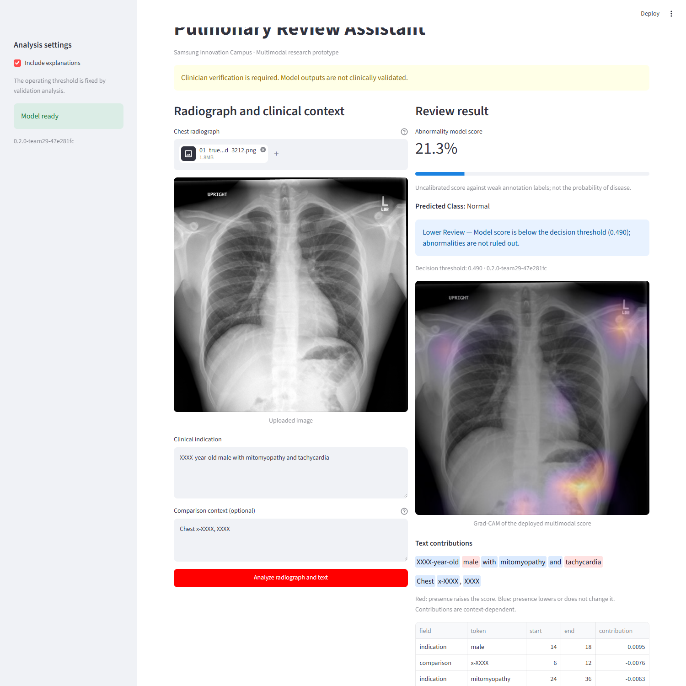
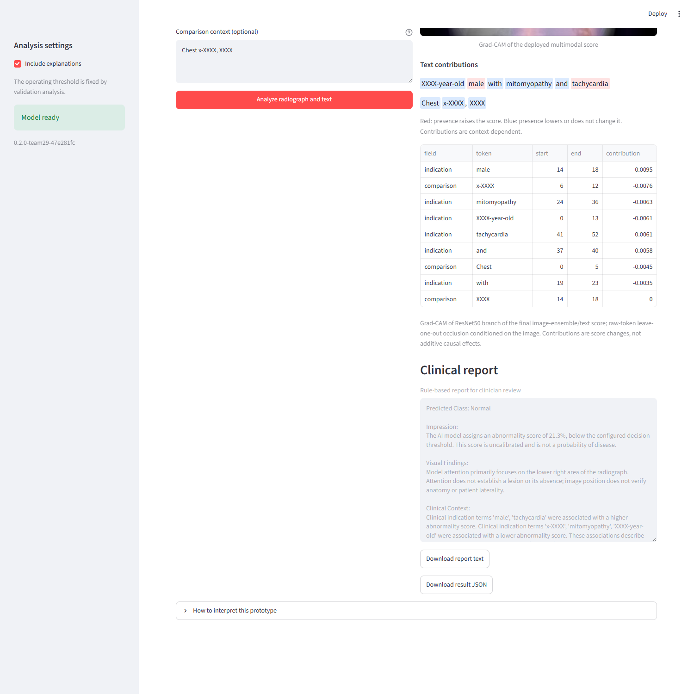
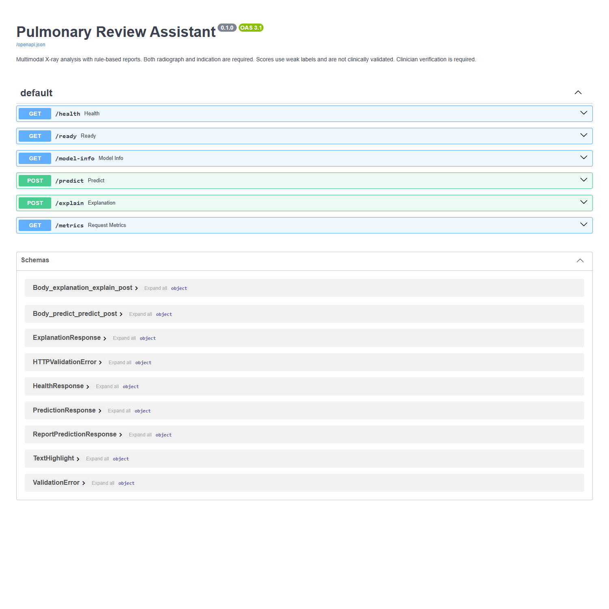

# Demonstration runbook - 0.2.0 Team29

Model **0.2.0-team29-47e281fc**; threshold **0.49**; fusion **70% image / 30% text**.
Held-out study accuracy **82.87%**, F1 **0.7918**, ROC-AUC **0.8816**.
The UI analyzes one image; evaluation averages available views per study.

## Preflight and Docker startup

Open PowerShell in the project root, with Docker Desktop using Linux containers.
On the current machine, reuse the verified images:

```powershell
docker compose up -d --no-build --wait --wait-timeout 180
docker compose ps
Invoke-RestMethod http://localhost:8080/ready
Invoke-RestMethod http://localhost:8080/model-info
Start-Process http://localhost:8501
Start-Process http://localhost:8080/docs
```

Both services must be healthy. Model info must show the version above,
`team29_late`, threshold 0.49 and the 384-pixel preprocessing version.
The bundle is mounted read-only from `artifacts/team_bundle`.

For a fresh checkout, restore the separately supplied model archive first:

```powershell
Expand-Archive -LiteralPath dist/SIC_0.2.0-team29_model_bundle.zip -DestinationPath . -Force
Expand-Archive -LiteralPath dist/SIC_0.2.0-team29_tracking_evidence.zip -DestinationPath . -Force
docker compose build
docker compose up -d --wait --wait-timeout 180
```

The archive contains paths under `artifacts/team_bundle/`. Weights and raw data
are excluded from Git: transfer this archive alongside the source submission.
For code-only changes with an existing trusted image and unchanged dependencies:

```powershell
docker build -f Dockerfile.update -t sic_graduation_project-api:latest .
docker compose up -d --no-build --wait --wait-timeout 180
```

A clean dependency build downloads libraries and needs substantially more free
disk space. Use the existing image for the presentation.

## Live UI demonstration - approximately three minutes

Use `demo_images/team29/`. Copy both indication and comparison exactly from
`demo_images/demo_cases.csv` or each `_context.txt` file.

| Order | Image | Weak label / result | Single-image score |
| --- | --- | --- | ---: |
| 1 | 01_true_negative_uid_3212.png | Normal / Normal | 21.34% |
| 2 | 02_true_positive_uid_2348.png | Abnormal / Abnormal | 90.79% |
| 3 | 03_false_positive_uid_2829.png | Normal / Abnormal | 71.06% |

1. Show the sidebar model version and explain the two inputs.
2. Upload the Normal case, paste its context and click **Analyze radiograph and text**.
3. Explain the fixed threshold, score and illustrative priority. It is not calibrated disease risk.
4. Inspect Grad-CAM and signed token occlusion: not SHAP, anatomical segmentation or causal proof.
5. Read the five-section report and download its text/JSON.
6. Repeat for the Abnormal case and the false positive to show limitations.





The false positive is against a weak label, not an adjudicated diagnosis. These
cases were selected after evaluation to demonstrate behavior, not estimate performance.

## API and evidence demonstration

Show Swagger, readiness, model info, prediction and explanation. The preserved
UID 1330 demo also works with an empty comparison field; its current score is
approximately 18.54%, Normal, and it differs from the first case above.

```powershell
curl.exe --fail-with-body -X POST http://localhost:8080/predict -F "image=@demo_images/01_true_negative_uid_1330.png" -F "indication=XXXX-year-old male with shortness of breath."
docker compose logs --tail 20 api ui
```



Show saved missing-image 422 and missing-model 503 tests from the evidence.
No live model files need to be removed. Current results and checks are in
`reports/evidence/team29/` and `docs/technical_evidence_report.docx`.

## Automated demo and recorded fallback

```powershell
.\.venv\Scripts\python.exe scripts/automated_demo.py --headless --output-dir reports/generated/submission/demo
$demoVideo = [System.Uri]::new((Resolve-Path docs/demo_fallback.webm).Path)
Start-Process msedge.exe -ArgumentList $demoVideo.AbsoluteUri
```

`docs/demo_fallback.webm` is a real silent recording of UID 1330 upload, indication,
analysis, written report and JSON download, using the current deployed version.
Narrate it live if the application is unavailable. The verification record stores
model version, source image hash, capture time and video file size. Recreate it with:

```powershell
.\.venv\Scripts\python.exe -m playwright install ffmpeg
.\.venv\Scripts\python.exe scripts/automated_demo.py --headless --output-dir reports/generated/submission/demo --record-video docs/demo_fallback.webm
```

The full recording was playback-verified in Microsoft Edge. To view the restored
portable tracking database, run from the project root:

```powershell
.\.venv\Scripts\python.exe -m mlflow ui --backend-store-uri sqlite:///artifacts/team_classification/mlflow.db --host 127.0.0.1 --port 5000
```

## Presenter facts and recovery

| Topic | Statement |
| --- | --- |
| Main result | 82.87% accuracy / 0.8816 ROC-AUC on 356 studies |
| Tradeoff | Precision 83.45%, recall 75.32%; ResNet50 has higher F1 |
| Old results | Different v1 cohort and 10:1 policy; not directly comparable |
| Reporting | Deterministic default; learned FLAN-T5 adapter experimental |
| Overlap | XRV lists OpenI pretraining; specific test-image membership unproven |
| Clinical limit | Weak labels, uncalibrated scores and no external clinical validation |

If not ready, check API logs and the four bundle files. Identify a port's owner
before stopping any process. Use the fallback while resolving environment issues.
Do not change the model or threshold during the demo. Each member should rehearse;
an automated recording does not establish the team's understanding.
