# Technical Evidence & Working Solution

Multimodal Clinical Decision Support for Pulmonary Pathology — SIC AI Track

Current submission: 28 October 2026. All primary results below belong to
**0.2.0-team29-47e281fc**. This replaces the previous technical evidence
document's current-model narrative; historical v1 records remain separately available.
Source: SIC handbook, page 17, “The complete submission package”.

## 1. System, Data Assets and Reproduction

| Property | Current value |
| --- | --- |
| Model bundle | `artifacts/team_bundle/manifest.json` |
| Classifier | ResNet50 + DenseNet121 image ensemble, TF-IDF Logistic Regression |
| Fusion | 70% image ensemble + 30% text |
| Decision threshold | 0.49; selected by validation balanced accuracy |
| Evaluation unit | Study mean across available views; UI input is one image |
| Default report | Rule-based evidence summary; clinician verification required |
| Source modules | `team_classification.py`, `team_features.py`, `team_inference.py` |


The Indiana University collection is distributed through NLM Open-i; this project
uses the `raddar/chest-xrays-indiana-university` Kaggle mirror. The local source has
3,851 reports and 7,466 image records. The selected cohort requires a frontal view,
retains at most one frontal and one lateral image and excludes uncertain and
poor-quality cases. It contains 2,371 studies and 4,543 image rows.

| Split | Studies | Image rows |
| --- | ---: | ---: |
| Train | 1,660 | 3,179 |
| Validation | 355 | 683 |
| Held-out test | 356 | 681 |

| Field | Definition / permitted use |
| --- | --- |
| uid | Report/study identifier; not a verified patient identifier |
| filename / projection | Image pairing and frontal/lateral view metadata |
| indication | Pre-examination clinical context; classifier input |
| comparison | Prior-study context; optional classifier input |
| findings / impression | Current interpretation; excluded from classifier predictors |
| Problems / MeSH | Structured weak-label sources; never classifier features |
| target | Normal=0, Abnormal=1; uncertain cases excluded |

Normal requires the exclusive Normal problem tag with no core abnormal tag.
Abnormal uses ten core groups, including cardiomegaly and fractures as well as
pulmonary findings. Contradictory cases are uncertain. A strict labeling rule moves
57 chronic-only cases with a first-sentence “no acute” impression to uncertain.
That impression is used for cohort labeling, not as a predictor. The target is a
broad weak thoracic proxy, not an adjudicated pathology diagnosis.

Both views of a UID stay together. The selected cohort's SHA-256 audit found no
exact duplicated image rows and required no split reassignment. Near duplicates
and true patient independence are not established. Shared preprocessing uses
grayscale, aspect-preserving Lanczos padding to 384 × 384, RGB conversion and
ImageNet normalization. Data dictionary and both experiment profiles are in
`docs/data_assets.md`; source hashes are in the cohort manifest.

## 2. Experiment Tracking & Tuning

| Training component | Recorded configuration |
| --- | --- |
| Image training | 3 head + up to 15 fine-tuning epochs; batch size 8 |
| Optimization | AdamW; ReduceLROnPlateau; class-weighted cross-entropy |
| Early stopping | Patience 2 on validation loss; frozen BatchNorm statistics |
| Retained checkpoints | ResNet50 epoch 7; DenseNet121 epoch 10 |
| Completed image epochs | ResNet50 10; DenseNet121 12 |
| Text search | 6 C values × 2 class-weight settings = 12 validation comparisons |
| Fusion search | 21 image weights; validation ROC-AUC objective |
| Threshold search | Validation balanced accuracy; test not used for selection |
| Tracking | Separate `artifacts/team_classification/mlflow.db` |

TF-IDF word/character vocabularies and metadata scaling are fitted on training
data only. Indication/comparison are cleaned and label terms masked. Final
selection is frozen in `selection.json` before the test evaluation lock is written.
Image training and final evaluations are tracked with manifests, hashes, metrics
and plots. The test results were not used to select the deployed weight or cutoff.

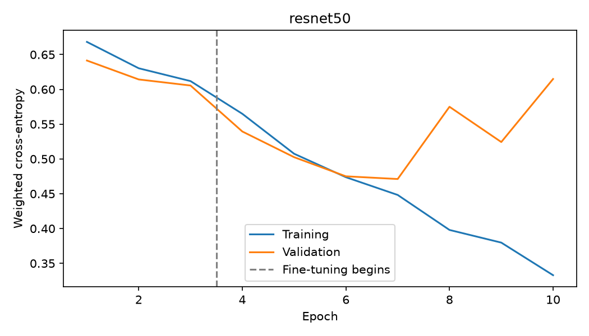

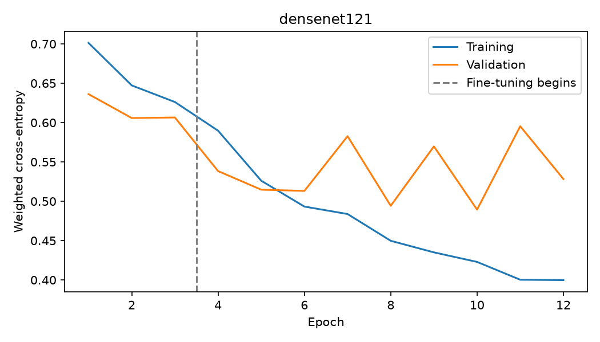

The GTX 1660 SUPER run uses AMP with a tested legacy-cuDNN benchmark configuration.
Deterministic cuDNN FP16 returned NaNs; invalid forward passes were recomputed in
FP32. Backend correction and a disk-exhaustion interruption required checkpoint
restarts and optimizer reinitialization. Interrupted MLflow runs retain their
failure/cancellation statuses. Seeds are recorded, but bitwise reproducibility is
not promised with benchmark-selected GPU algorithms. This is a local reproduction
of the team's approach, not their unavailable classification weights.

Historical v1 Optuna tuning completed 20 trials and is retained as development
evidence. It belongs to a different cohort/text pipeline and is not claimed as
new tuning for this model. Its linear/tree/CNN comparisons remain historical.

### MLflow experiment tracking and Optuna optimization history

The current database contains **10 runs** in
`team29-classification-reproduction`: 7 FINISHED,
2 KILLED and 1 FAILED.
Five finished runs log frozen test evaluations; the other two finished runs are
CNN training. Interrupted attempts remain visible rather than being discarded.
MLflow records parameters, epoch training/validation losses, final test metrics,
selection manifests, checkpoint hashes and saved plots. Training runs record the
seed and source digest; final evaluation runs link the cohort/selection manifests.

| Model family / representative | MLflow run prefix | Test accuracy | Test F1 | Test ROC-AUC |
| --- | --- | ---: | ---: | ---: |
| Text-only | `e23dfcb3` | 66.29% | 0.5652 | 0.7203 |
| ResNet50 | `1c3b1b62` | 82.30% | 0.7961 | 0.8784 |
| Multimodal Fusion | `92fa3596` | 82.87% | 0.7918 | 0.8816 |

These metrics are read directly from the three frozen-evaluation MLflow runs,
covering text-only, image-only and multimodal families on the same 356 test studies.
Full run IDs, statuses, parameters and metrics are in
`reports/evidence/team29/mlflow_tracking_snapshot.json`.


**Current validation search.** The text model compares 12 settings (six C values,
two class-weight settings). Its selected C is **0.3**, class weighting is **None**,
solver is **liblinear**, and validation ROC-AUC is **0.6726**.
Fusion compares 21 image weights using validation ROC-AUC and selects **70% image /
30% text**. Balanced-accuracy threshold selection on validation gives **0.49** for
fusion. CNN early stopping uses patience 2; retained checkpoints are ResNet50
epoch 7 and DenseNet121 epoch 10. This current search is not an Optuna study.

**Historical Optuna study — separate cohort and feature pipeline.**
`tracking_snapshot.json` records **37 historical MLflow runs**.
`optuna_trials.csv` records **20 completed trials**, numbered 0–19,
using seeded TPE to maximize mean grouped training-fold ROC-AUC. TF-IDF is refitted
within each fold. Search bounds are C in [0.001, 100] (log scale) and max_features
in {500, 1000, 2000}. The best trial is **7**, with mean CV ROC-AUC
**0.6406**, C = **0.9163741809** and max_features = **1000**.
The classifier uses balanced class weights. These are historical development
results, not the deployed text model's settings or new test-set tuning.

| Historical trial (zero-based) | Trial mean CV ROC-AUC | Best observed through this trial |
| --- | ---: | ---: |
| 0 | 0.6307 | 0.6307 |
| 4 | 0.6270 | 0.6378 |
| 9 | 0.6286 | 0.6406 |
| 19 | 0.6354 | 0.6406 |

The chart includes every trial and its cumulative best; the full CSV preserves
parameters, states, timestamps and duration. Current threshold and fusion choices
were frozen on validation before final test evaluation. No test metric is used
as a tuning objective.

**Inspect the local MLflow dashboard.** Run from the project root:

```powershell
.\.venv\Scripts\python.exe -m mlflow ui --backend-store-uri sqlite:///artifacts/team_classification/mlflow.db --host 127.0.0.1 --port 5000
```

Open `http://127.0.0.1:5000` and select `team29-classification-reproduction`.
Compare the five `*-frozen-evaluation` runs using `test_accuracy`, `test_f1` and
`test_roc_auc`; inspect CNN runs for loss histories. The historical database can
be viewed separately with `--backend-store-uri sqlite:///artifacts/mlflow.db`
on port 5001. Databases/artifact directories are excluded from Git; restore the
separate tracking archive before opening the current dashboard on a fresh checkout.
The summary chart remains viewable without either database.


## 3. Held-out Model Comparisons

All rows below use the same current test cohort, 356 studies / 681 source images.
Accuracy and F1 use each model's own validation-selected threshold. F1 is for the
Abnormal weak-label class.

| Model | Accuracy | F1 | ROC-AUC | Threshold |
| --- | ---: | ---: | ---: | ---: |
| Text-only — Logistic Regression | 66.29% | 0.5652 | 0.7203 | 0.49 |
| ResNet50 | 82.30% | 0.7961 | 0.8784 | 0.44 |
| DenseNet121 | 79.21% | 0.7658 | 0.8644 | 0.46 |
| Image ensemble | 81.74% | 0.7855 | 0.8757 | 0.48 |
| Multimodal Fusion | 82.87% | 0.7918 | 0.8816 | 0.49 |


The deployed fusion achieves precision **83.45%**, recall
**75.32%** and average precision **0.8516**.
It slightly improves accuracy and ROC-AUC over ResNet50, while ResNet50 has the
higher F1. No statistical superiority or clinical effectiveness is established.
The old 10:1 cost policy is not used in this model. Its earlier, high-recall v1
scores used a different cohort and are not directly comparable.

| Model | True negative | False positive | False negative | True positive |
| --- | ---: | ---: | ---: | ---: |
| Text-only — Logistic Regression | 158 | 44 | 76 | 78 |
| ResNet50 | 170 | 32 | 31 | 123 |
| DenseNet121 | 161 | 41 | 33 | 121 |
| Image ensemble | 172 | 30 | 35 | 119 |
| Multimodal Fusion | 179 | 23 | 38 | 116 |

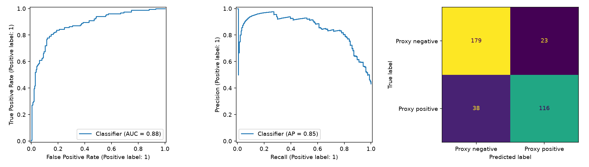

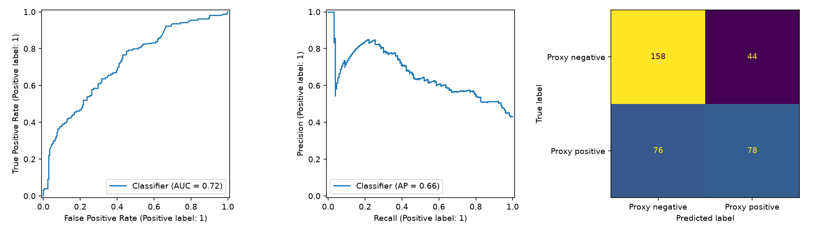

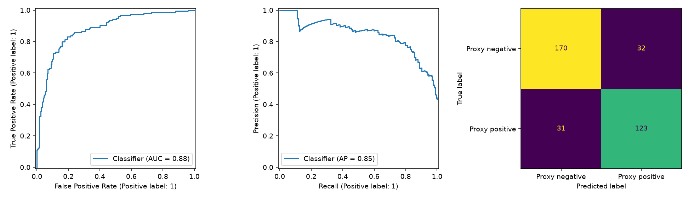


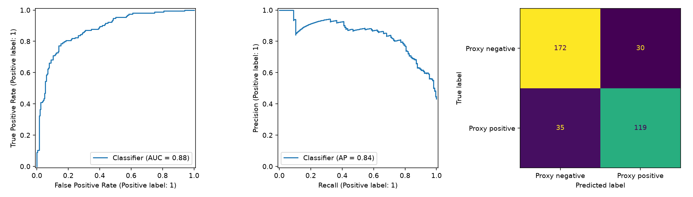

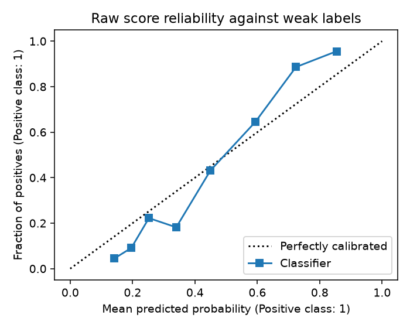

The reliability plot is descriptive; no probability calibrator was fitted. Scores
remain uncalibrated and must not be interpreted as disease probabilities.

## 4. Explanation Plots and Written Reports

Grad-CAM differentiates the final fused score at the ResNet50 branch. It explains
that branch's contribution, not a combined anatomical map of both CNNs. Token
occlusion removes one raw token and measures the change in the final score with
image scores fixed. This is **token occlusion, not SHAP**. Changes are not additive
causal effects. Image coordinates do not establish anatomy or patient laterality.

| Selected test example | Weak label | Model outcome | Single-image score |
| --- | --- | --- | ---: |
| UID 3212 | Normal | True negative | 21.34% |
| UID 2348 | Abnormal | True positive | 90.79% |
| UID 2829 | Normal | False positive | 71.06% |

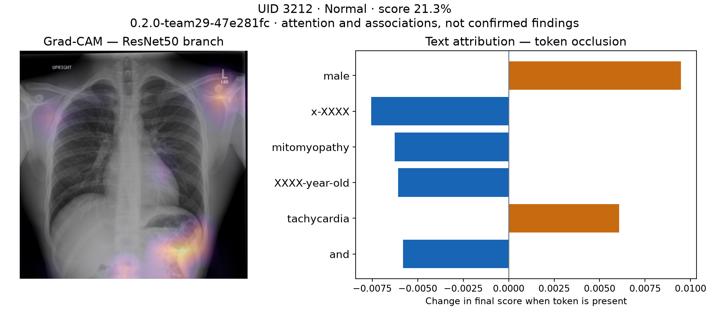

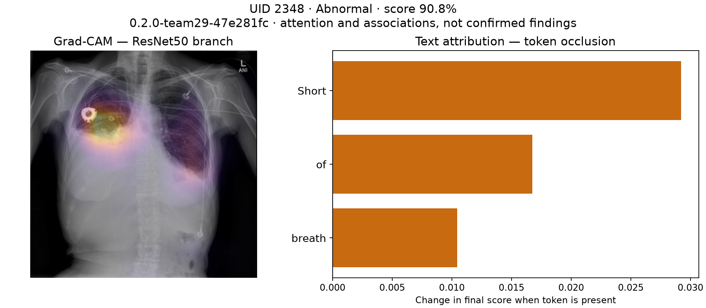

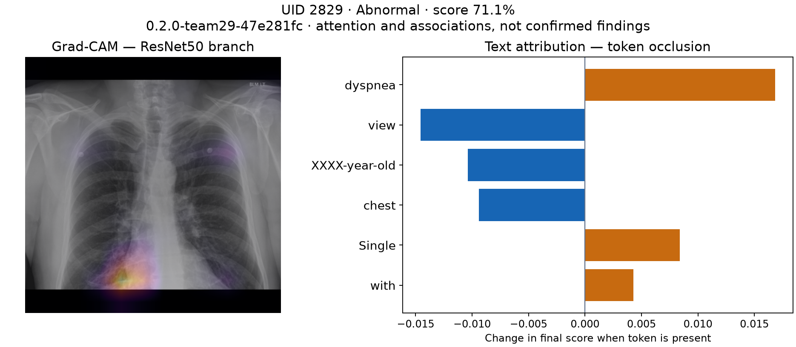

The cases were selected after evaluation to demonstrate behavior, not to estimate
performance. Study metrics average views; these interface scores use one image.
Exact indication/comparison fields are in `demo_images/demo_cases.csv`.

The rule-based report contains Predicted Class, Impression, Visual Findings,
Clinical Context and Recommendation. It describes scores and attribution rather
than asserting that attention proves a lesion. Every report retains
“Clinician verification is required.”


## 5. Team Notebook Analysis & Data Leakage Prevention

The team's classification notebook was inspected and ported into source modules.
Missing trained classification exports required local retraining. Image/text
alignment, permitted predictors, train-only fitting and grouped evaluation were
checked. Ambiguous image names/conflicting UIDs are rejected, exact-image hashes
are audited, and thresholds/fusion choices are selected on validation only.

The team's first report generator used FLAN-T5-small with ResNet18 visual tokens and
XRV pathology tags. Its XRV `densenet121-res224-all` configuration explicitly lists
**OpenI** among pretraining sources, and Indiana IU radiographs come from the
OpenI/NLMCXR collection. This documents **dataset-source pretraining overlap**.
Without the upstream per-image training manifest, it does **not** prove that a
particular local test image or patient was seen; it is not accurate to claim proven
image-level test leakage or quantify its effect from the available files.

Sources: [XRV model definition](https://github.com/mlmed/torchxrayvision/blob/master/torchxrayvision/models.py)
and [XRV OpenI dataset implementation](https://github.com/mlmed/torchxrayvision/blob/master/torchxrayvision/datasets.py).
The deployed classifier uses ImageNet weights and does not use this XRV component.

The final notebook, `notebooks/Team29_Report_Generation_Final.ipynb`, removes that
tagger. Tags come from a linear classifier trained on IU training studies only, on
1024-D features from the CheXpert-only `densenet121-res224-chex` weights; training
tags are out-of-fold. After generation, a fixed finding sentence is added when the
classifier is confident, using thresholds that reach 60% out-of-fold training
precision. `src/pulmonary/learned_reports.py` loads this export and rejects exports
built with the OpenI-trained weights.

| Reporting option | Evidence | Decision |
| --- | --- | --- |
| Rule-based evidence summary | Deterministic, faithful to classifier/XAI inputs; not a learned radiology report | Default in API/UI |
| Team learned FLAN-T5 draft (final notebook) | Notebook reload verified prompts, classifier probabilities and forced findings; fluent text with omission risks | Experimental adapter only |

The notebook's supplied test results (362 studies) for the final model are BLEU 18.5 /
ROUGE-L 0.391 / METEOR 0.339. Lexical finding checks found cardiomegaly in 7/23
reference cases (14 mentions), atelectasis in 2/45 (7) and opacity in 15/70 (53);
granuloma was dropped because its classifier was too weak. The superseded
OpenI-tagger run had BLEU 17.30 / ROUGE-L 0.377 / METEOR 0.326 with cardiomegaly
7/23, atelectasis 1/45 and opacity 9/70. These are limited lexical checks and
language-similarity metrics, not clinician-adjudicated diagnostic accuracy, and
they were not re-run in this repository. The test split was evaluated four times
during notebook development, so these are not untouched-holdout results. Splits are
by study, not patient. Image swaps move both visual tokens and tags, so they do not
isolate the visual-token branch. The full notebook analysis and reporting decision
are consolidated in this report.

## 6. Functional Tests and Working Solution

| Check | Saved evidence | Result |
| --- | --- | --- |
| Focused regression tests | `reports/evidence/team29/pytest.txt` | 13 passed |
| Export/software parity | Team bundle checksums, direct-vs-fused score tests | Passed |
| API prediction/explanation | `deployment_verification.json` | HTTP 200; matching version/scores |
| Invalid missing image | Same deployment verification | HTTP 422 |
| Three real demo predictions | `demo_prediction_verification.json` | All matched local export |
| Container UI report rendering | Same deployment verification | Passed |
| Real browser upload/report/download | `automated_demo.json` | Passed |
| Both Compose services | Saved Docker evidence and live `/ready` | Healthy |

The 13 tests cover predictor exclusion, aspect-preserving padding, study-label
consistency, validation thresholds, import checksum rejection, real fusion parity,
Grad-CAM/report generation, API validation/readiness and Streamlit rendering.
Artificial test weights are software fixtures and are not the source of quality
metrics. Real model quality comes from the frozen held-out outputs above.

```text
............. [100%]
13 passed in 24.75s
```

| Runtime component | Configuration |
| --- | --- |
| API | FastAPI, CPU inference, localhost:8080 |
| UI | Streamlit, localhost:8501; internal API URL http://api:8080 |
| Model mount | `artifacts/team_bundle` → `/models`, read-only |
| Model version | 0.2.0-team29-47e281fc |
| Recorded /predict latency | 3.57 seconds for selected case; not a benchmark |
| Failure behavior | Unavailable model → readiness/inference 503; no invented scores |


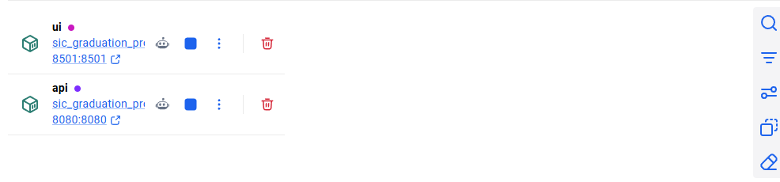


Start from the project root:

```powershell
docker compose up -d --no-build --wait --wait-timeout 180
docker compose ps
Invoke-RestMethod http://localhost:8080/ready
Invoke-RestMethod http://localhost:8080/model-info
```

A fresh checkout needs a trusted complete model bundle first. Model binaries and
raw data are excluded from Git. The offline bundle archive is packaged separately
under `dist/`; restore its files into `artifacts/team_bundle/`. A clean dependency
build uses `docker compose build`; an existing trusted image supports the smaller
code-only `Dockerfile.update` build. See README and `docs/demo_runbook.md`.

## 7. Submission Package and Limits

| SIC item | Artifact / evidence |
| --- | --- |
| 01 Source code | `src/`, `app/`, `ui/`, `scripts/`, `tests/` |
| 02 Technical documentation | README, architecture, dependencies and execution guides |
| 03 Data assets | `docs/data_assets.md`, provenance, dictionary, split manifest |
| 04 Technical evidence | This report, tracked searches, comparison/XAI plots and tests |
| 05 Working solution | Versioned model bundle, offline archive and verified Compose stack |
| 06 Presentation | `docs/SIC_Final_Presentation.pptx`, current notes and inserted assets |
| 07 Demonstration | `docs/demo_runbook.md`, automation and recorded fallback |
| 08 Team contribution summary | `team_contributions.md` |

The exact checklist is recorded in `docs/final_submission_checklist.md`. Technical
package checks do not substitute for each member's rehearsal or understanding.
There is no external clinical validation, verified patient grouping or prospective
workflow-benefit measurement. Historical test results were already visible during
project development; this is not a new independent external validation study.
Clinician verification is required.
